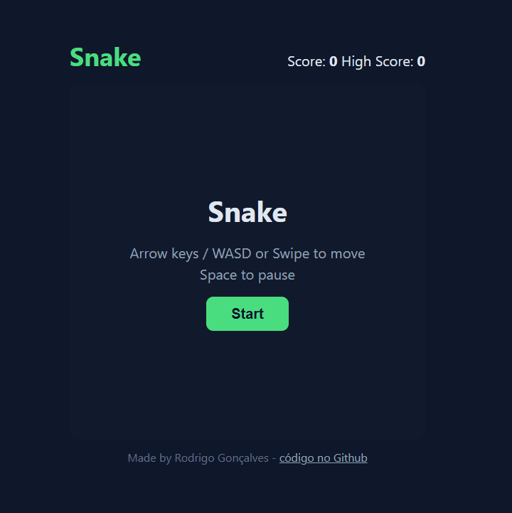

# Snake

<p align="center">
    <br>
    <a href="https://rodrigosogoncalves.github.io/snake"><b>Play it here</b></a>
</p>

## Controls
| Action | Keyboard | Mobile |
| --- | --- | --- |
| Move | Arrow Keys / WASD | Swipe |
| Start / Pause | Space | Tap the button |

## Features
- Speed increases with every apple eaten
- High score saved locally (`localStorage`)
- Food always spawns on a free cell
- Start, pause and game over screens
- Works on desktop and mobile

## What I learned with this project
- State Machines: modelling an app as clear states (menu, playing, paused, game over) with defined transitions; a pattern used in UIs, games and backend workflows
- Event-driven programming: reacting to keyboard and touch events instead of running code top to bottom.
- Separating logic from rendering: the `step` function updates the data and `draw()` only displays it, the same idea behind frameworks like React.
- Input buffering and edge cases: storing the next direction so that two fast key presses can't cause an invalid move.
- Debugging with DevTools: reading console errors to trace bugs.
- Version control: building the project in small, working commits.
- Client-side persistence: saving data in the browser with `local storage`.

## Run locally
Clone the repo and open `index.html` in your browser:
```bash
git clone ttps://github.com/rodrigosogoncalves/snake.git
```

## Author
Rodrigo Gonçales - AI & Data Science student at FCUP